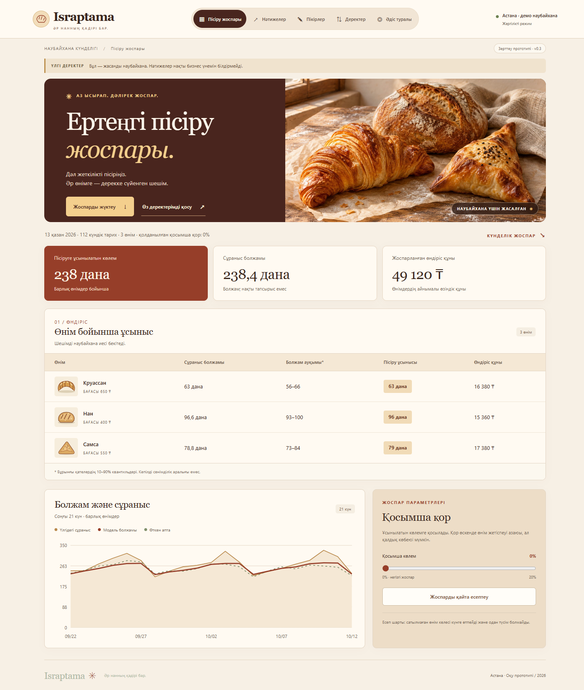

# Israptama

Israptama helps small bakeries plan what to bake tomorrow. It forecasts sales by product and recommends quantities based on the cost of unsold stock and the margin lost when a product sells out. The dashboard is in Kazakh.

[Live demo](https://israptama.vercel.app/) · [Run locally](#run-locally) · [Mobile preview](preview-mobile.png) · [Research presentation](https://israptama.vercel.app/presentation.html)



## What it does

- Forecasts next-day sales by product and recommends how much to bake, with an optional safety-stock adjustment.
- Compares a 21-day backtest with a last-week-sales baseline. The dashboard shows forecast error, simulated contribution profit, leftovers, and unmet demand where the synthetic dataset provides demand.
- Accepts a sales CSV and exports a baking plan as CSV or an evaluation report as JSON.
- Includes a separate English recipe-review experiment. The **Пікірлер** view compares two classifiers that flag low-rated reviews. This experiment is independent of the baking plan.

## Tech stack

- **Frontend** — HTML, CSS, and vanilla JavaScript in `public/`.
- **Local server** — Python's standard-library HTTP server in `app.py`. The hosted demo uses the same API through a Vercel Python Function.
- **Forecasting and planning** — NumPy for Ridge regression, with price and unit cost used to choose a production quantity.
- **Review experiment** — scikit-learn for TF-IDF and logistic regression, with model artifacts loaded via joblib.

## Run locally

Install Git and Python 3.11 or 3.12. The demo runs without an account, API key or frontend build.

```sh
git clone https://github.com/LordGibrat/israptama.git
cd israptama
python -m venv .venv
```

**Windows PowerShell**

```powershell
.\.venv\Scripts\python.exe -m pip install -r requirements.txt
.\.venv\Scripts\python.exe app.py
```

**macOS / Linux**

```sh
.venv/bin/python -m pip install -r requirements.txt
.venv/bin/python app.py
```

Open [http://127.0.0.1:8765](http://127.0.0.1:8765). The synthetic sample loads automatically. Select **Нәтижелер** to compare the backtest, **Деректер** to import a CSV, or **Пікірлер** to try a sample English review. Stop the server with Ctrl+C.

For CSV imports, use UTF-8 with the columns `date,product,baked,sold,price,cost`. Each product needs 77–730 consecutive daily records and the same ending date. Use one row per date and product, integer quantities with `sold ≤ baked`, and prices with `0 < cost < price`. The file can contain up to 20 products, 15,000 rows and 2 MB. Download the full synthetic sample from **Деректер** for a valid example. On the hosted demo, inputs are processed in memory by a Vercel Function. Run locally when working with private bakery data.

## Results and reproducibility

The planning evaluation uses synthetic sales. It produced higher simulated contribution profit than the baseline and also more unsold units. Uploaded sales can understate demand on stockout days. See [planning results and assumptions](RESULTS.md) for the measured tradeoff and [the project notes](PROJECT_NOTES.md) for validation status.

The separate NLP study uses the [UCI Recipe Reviews and User Feedback dataset](https://archive.ics.uci.edu/dataset/911/recipe+reviews+and+user+feedback+dataset) under CC BY 4.0. Its held-out evaluation measures low-rating classification on English reviews. See [the research protocol and results](NLP_RESEARCH.md) and [assignment evidence](ASSIGNMENT_EVIDENCE.md).

In the virtual environment, run `python -m unittest discover -s tests -v` for unit and HTTP tests, or `python research/run_experiment.py --check` to download the UCI archive and reproduce the NLP experiment.

[Design notes](DESIGN.md) · [Presentation notes](presentation/NOTES.md) · [Test workflow](https://github.com/LordGibrat/israptama/actions/workflows/tests.yml)

Independent student prototype inspired by [Afresh’s public bakery workflow](https://www.afresh.com/departments/bakery). No license has been selected for this repository.
