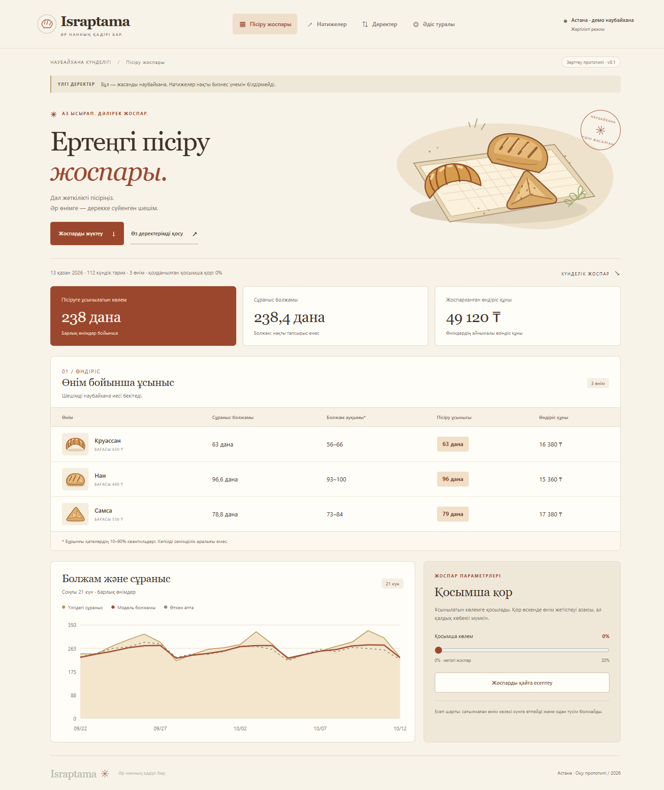

# Israptama — bakery production planning prototype

[](https://github.com/LordGibrat/israptama/actions/workflows/tests.yml)

An AI-assisted decision-support prototype for small bakeries in Kazakhstan. It forecasts sales, recommends daily baking quantities, and compares the financial tradeoff between unsold stock and unmet demand. The interface is in Kazakh; the documentation is in English.

**Status:** working local prototype, evaluated on synthetic data only. No real bakery pilot or verified savings yet.

**Customer discovery:** initial outreach to five bakeries in Astana; responses and real-data validation are pending.



Independent student project inspired by the publicly described Afresh workflow: sales history → demand forecast → production recommendation → business evaluation. No affiliation with Afresh and no access to its code, models, or customer data.

## Quick start

Requires Python 3.11 or later. Run from the repository root:

```bash
python -m venv .venv
```

Activate with `.venv\Scripts\Activate.ps1` on Windows PowerShell or `source .venv/bin/activate` on macOS/Linux, then:

```bash
python -m pip install -r requirements.txt
python app.py
```

Open [http://localhost:8765](http://localhost:8765). No API key or account is required. Keep the terminal running. Stop with Ctrl+C.

## Initial experiment

Evaluated on 336 synthetic records across three products, using a 21-day walk-forward test:

| Measure | Last-week-sales baseline | Israptama |
|---|---:|---:|
| Forecast WAPE (lower is better) | 8.44% | 7.55% |
| Simulated contribution profit | 1,605,170 ₸ | 1,631,890 ₸ |
| Simulated unsold units | 69 | 85 |

Profit increased in the simulation, but waste also increased. These results demonstrate the tradeoff, not real-world waste reduction. See [RESULTS.md](RESULTS.md) for assumptions and the full comparison.

## Open the app

On this computer, right-click `start.ps1` and run with PowerShell, or:

```powershell
powershell.exe -NoProfile -ExecutionPolicy Bypass -File .\start.ps1
```

Then open http://localhost:8765. Keep the terminal running. If the port is occupied, use `-Port 8766`. The server binds only to 127.0.0.1.

On another computer: install Python 3.11+ and run:

```text
python -m pip install -r requirements.txt
python app.py
```

## What works

- Kazakh dashboard: plan, evaluation, data upload, and methodology.
- Bakery editorial design inspired by researched Lapa Ninja/Awwwards references: flour-cream and terracotta palette, serif typography, original SVG products, and responsive navigation. See `DESIGN.md` for reference attribution; no third-party artwork is copied.
- Seeded synthetic sample: 112 days, 336 records, croissants, bread, samsa; ending 2026-10-12. These fixed dates make the experiment reproducible. “Tomorrow” means the day after the dataset, not automatically today's actual date.
- Product-level NumPy Ridge regression using weekday, linear trend, last-week sales, and previous-seven-day mean. No LLM/API service is used.
- Cost-sensitive recommended quantity using `(price-cost)/price` quantile of held-out residuals; optional 0–20% extra stock.
- Last-21-day walk-forward evaluation versus last week's same-day SALES (not last week's production).
- CSV upload, production-plan download, JSON evaluation export, sample reset.
- No account, external APIs, telemetry, or uploaded-file persistence. CSV is held in browser memory and processed by the local server. Source code and test results are included.

## CSV input

```csv
date,product,baked,sold,price,cost
2026-07-01,Нан,100,85,400,160
```

Each product needs 77–730 consecutive daily records; all products must end on the same date. One row per date/product. Maximum 20 products, 15,000 rows, 2 MB. Use UTF-8 (BOM accepted), comma or semicolon delimiters, dot decimals, nonnegative integer quantities with sold ≤ baked, and 0 < cost < price. Quantities ≤ 1 million and unit money values ≤ 1 billion ₸. Do not invent zero sales for a missing record. The downloadable one-row template describes the schema; it is not sufficient training data.

The sample export also has `data_source=SYNTHETIC_DEMO`. Preserve this provenance. Its CSV contains only observable sales and production; latent demand is intentionally not exported. Re-uploading it runs an observed-sales scenario, so its metrics differ from the built-in simulation with known fictional demand. User uploads are not independently verified as real data.

## Honest evaluation

For each prediction date, only earlier rows are visible. The last 14 prior days are reserved for residual calibration; the remaining usable prior days train the regression. Features for each training/calibration row use only rows before that date. Calibration retains all observed-sales residuals, including stockouts, to avoid selecting only lower-demand days. This is not a censoring-aware latent-demand estimator; historic stockouts can still cause demand to be underestimated.

The sample's hidden demand is used only as the evaluation target, never for training or planning. Real CSV demand is unknown: observed sales are a lower bound when a product sells out. Accordingly, real uploads show a **scenario against observed sales**, not verified lost sales or savings. WAPE is absolute forecast error divided by total evaluation demand (or observed sales); lower is better. It is not an “accuracy percentage.” The 10–90% residual range is descriptive, not a guaranteed prediction interval.

Daily contribution profit = `min(quantity, demand) × price − quantity × unit cost`. All unsold items incur production cost. Assume no carryover, salvage revenue, substitutions, or capacity limits. Rent, wages, tax, other fixed costs, promotions, weather, and holidays are excluded. Model improvements on synthetic data do not establish real-world effectiveness. A model can lose to the baseline; the app reports that honestly.

## Reproduce

```text
python -m unittest discover -s tests -v
python prepare_demo.py
```

`data/SYNTHETIC-evaluation.json` contains exact row-level evaluation. `RESULTS.md` explains the initial result. Python compilation and JavaScript syntax were checked; desktop and mobile browser interactions were exercised.

## Next: bakery replies

1. Record interview responses separately, with consent; do not put private contacts in the repository.
2. Request daily baked/sold counts for 2–3 products, prices/costs, and dates. If the owner has less history, report the limitation and retain the demo rather than pretending to validate a model.
3. Import the anonymized CSV. Clarify stockouts and how leftovers are handled.
4. Show the recommendations to the owner; record feedback.
5. Describe verified interviews, prototype work, and simulated results separately in the application. Attribute AI assistance and explain the methodology yourself.

Public inspiration: https://www.afresh.com/departments/bakery

## Repository guide

- `engine.py`: validation, Ridge forecasting, cost-sensitive production planning, evaluation.
- `app.py`: localhost HTTP server and in-memory CSV processing.
- `static/`: responsive Kazakh UI, styles, and original SVG illustrations.
- `tests/`: 24 calculation and HTTP integration tests.
- `data/`: explicitly labeled synthetic data and evaluation results.
- `.github/workflows/tests.yml`: automated test configuration for GitHub, with action versions pinned to verified commit hashes. View runs in the repository's Actions tab.
- [DESIGN.md](DESIGN.md): visual references and artwork attribution.
- [PROJECT_NOTES.md](PROJECT_NOTES.md): development transparency and project status.
- [GITHUB_UPLOAD.md](GITHUB_UPLOAD.md): upload instructions and suggested repository description.

No license has been selected yet; this repository does not grant an explicit open-source reuse license.
